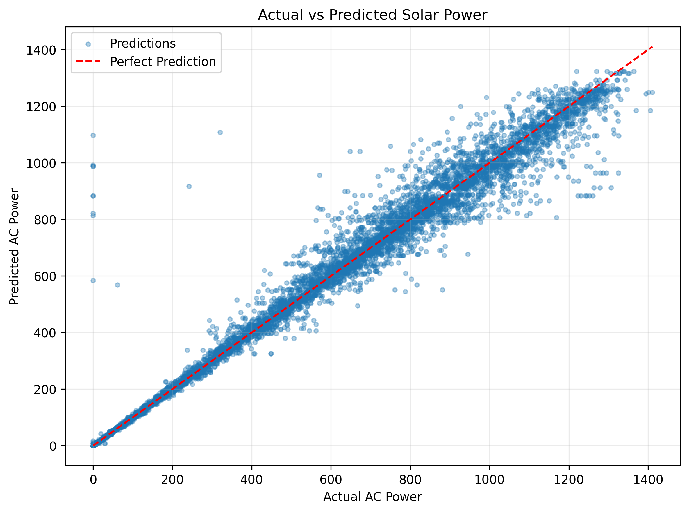
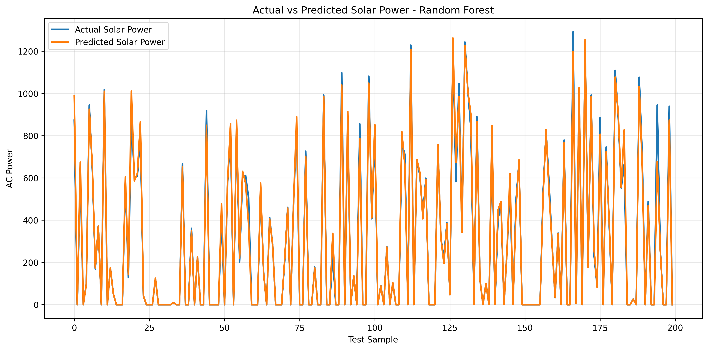

# Solar Power Prediction Using Random Forest

## Project Overview
This project uses Machine Learning to predict solar power generation using a Random Forest Regression model.

The model is trained and evaluated on a solar power generation dataset using weather-related features. Actual and predicted values are compared using visualization graphs.

## Algorithm
- Random Forest Regression

## Model Performance

| Metric | Value |
|---|---:|
| Mean Absolute Error (MAE) | 16.3731 |
| Root Mean Squared Error (RMSE) | 45.6698 |
| R-squared (R2) Score | 0.9865 |
| R-squared Percentage | 98.65% |

**Note:** R-squared is a model evaluation metric, not literal prediction accuracy. MAE and RMSE are expressed in the target variable's units.

## Visualizations

### 1. Actual vs Predicted Scatter Plot

This graph compares the actual solar power values with the model's predicted values.

### 2. Actual vs Predicted Line Graph

This graph compares actual and predicted solar power values across test samples.

## Project Output Files

- `Solar_Power_Prediction.ipynb` — Jupyter Notebook containing the project code
- `solar_power_predictions.csv` — Actual and predicted solar power values
- `actual_vs_predicted_scatter.png` — Scatter plot visualization
- `actual_vs_predicted_line.png` — Line graph visualization
- `solar_power_random_forest.pkl` — Saved Random Forest model

## Technologies Used

- Python
- Pandas
- NumPy
- Scikit-learn
- Matplotlib
- Google Colab
- GitHub

## Future Improvements

- Test the model on unseen data from different time periods.
- Compare Random Forest with other regression algorithms.
- Develop a simple interface for making predictions.
- Add a feature to predict solar power from new input data.

## Conclusion

The Random Forest Regression model achieved an R-squared score of 0.9865 on the current test dataset. The visualization graphs help compare the model's predictions with actual solar power values.

## Important Note

The reported metrics are based on the current test dataset. Performance on new data may differ.
